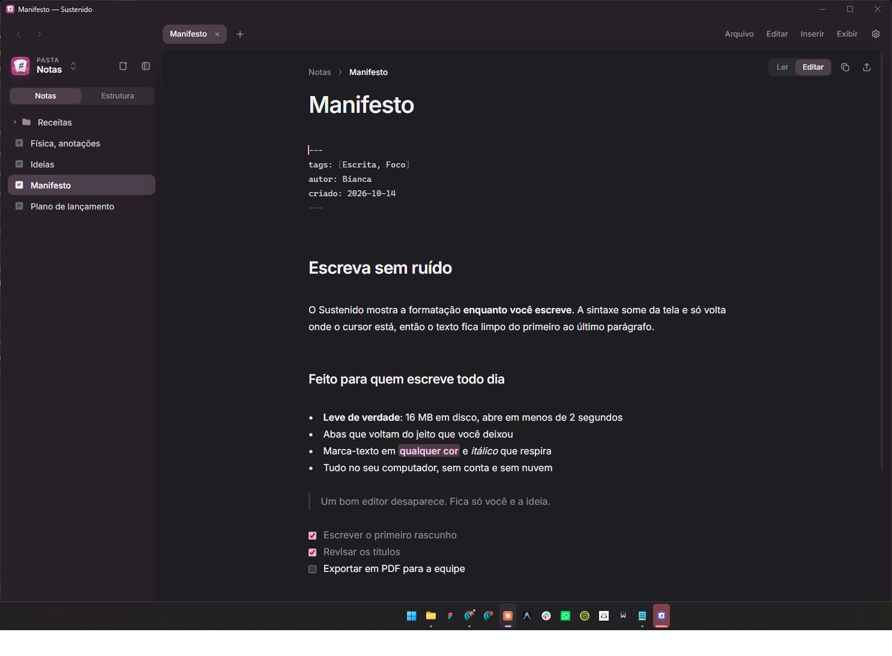
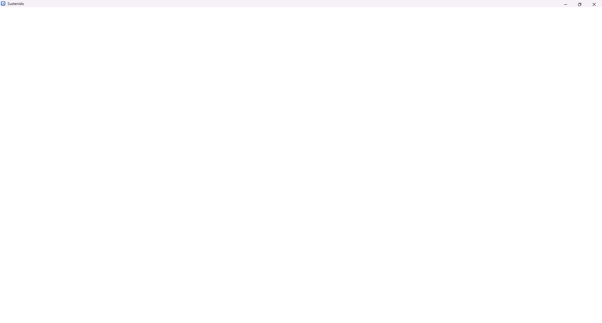
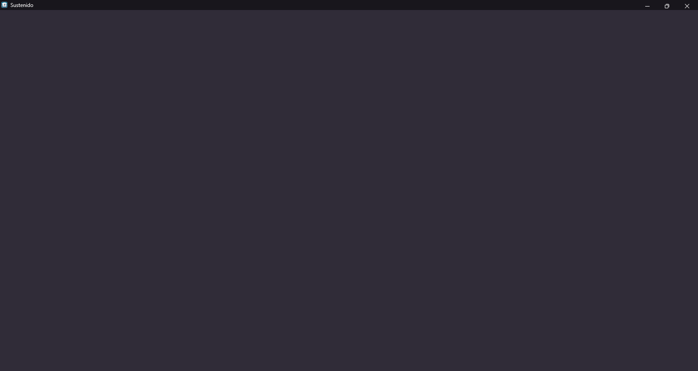
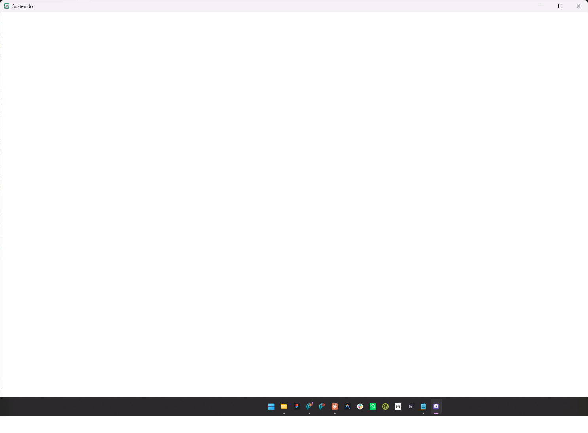

  

<h1 align="center">Sustenido</h1>

<strong>Escreva. A formatação acompanha.</strong> 
Editor de Markdown visual para Windows. Leve, rápido, offline e de código aberto.

  <a href="https://github.com/4yBibo/Sustenido/releases/latest"><strong>Baixar para Windows</strong></a> ·
  <a href="#recursos">Recursos</a> ·
  <a href="#atalhos">Atalhos</a> ·
  <a href="#desenvolvimento">Desenvolvimento</a>

  

---

## Por que Sustenido

Markdown é a forma mais simples de escrever, mas ler a sintaxe cansa. O Sustenido mostra o resultado enquanto você digita e esconde os símbolos quando o cursor está em outro lugar. O texto fica limpo do primeiro ao último parágrafo.

São **16 MB em disco**, abertura em **menos de 2 segundos** e nenhuma conta para criar. Tudo fica no seu computador.

## Recursos

**Escreva sem ruído**
- A formatação aparece enquanto você digita; a sintaxe só volta onde o cursor está
- Selecione um trecho e uma barra discreta oferece título, negrito, itálico, marca-texto, cor, código, link e emoji
- Marca-texto em qualquer cor, para separar ideias de um relance
- Tabelas rápidas: digite `| Item | Qtd |`, aperte Enter e a tabela se monta; Tab pula entre as células
- Parênteses, aspas, `*` e `_` se fecham sozinhos

**Fórmulas, diagramas e tabelas**
- Fórmulas LaTeX como `$E = mc^2$`, diagramas Mermaid e código com destaque de sintaxe
- Notas de rodapé, propriedades em YAML, links `[[entre notas]]` e imagens arrastadas direto para o texto

  
  

**Organize sem esforço**
- Abas que voltam do jeito que você deixou
- Sua pasta de notas na barra lateral, com subpastas
- Painel de estrutura com os títulos da nota, para pular de seção em seção
- Modo foco e modo máquina de escrever para textos longos

**Do rascunho ao arquivo final**
- Exporte para PDF, DOCX, HTML ou Markdown
- Importe HTML e PDF como Markdown
- Copie a nota já formatada para colar em documentos e e-mails

**Do seu jeito**
- Tema claro, escuro ou do sistema
- 20 cores de destaque, e o ícone do app acompanha a cor que você escolhe
- Efeito de vidro do Windows 11 e tamanho do texto ajustável

  

## Atalhos

| Ação | Atalho |
| --- | --- |
| Ler / editar | `Ctrl+E` |
| Nova aba · Abrir · Salvar | `Ctrl+N` · `Ctrl+O` · `Ctrl+S` |
| Localizar · Substituir · Ir para linha | `Ctrl+F` · `Ctrl+H` · `Ctrl+G` |
| Negrito · Itálico · Link | `Ctrl+B` · `Ctrl+I` · `Ctrl+K` |
| Marca-texto | `Ctrl+Shift+H` |
| Estrutura da nota | `Ctrl+Shift+O` |
| Modo foco · Máquina de escrever | `F8` · `F9` |
| Barra lateral | `Ctrl+\` |
| Próxima aba | `Ctrl+Tab` |
| Configurações | `Ctrl+,` |

## Instalação

Requisitos: Windows 10 ou 11, 64 bits. O WebView2 Runtime já vem no Windows 11.

1. Baixe o `.zip` mais recente em [Releases](https://github.com/4yBibo/Sustenido/releases/latest) e extraia.
2. Clique com o botão direito em `install.ps1` → **Executar com PowerShell**.

O instalador funciona só para o seu usuário, sem administrador. Ele registra o Sustenido para arquivos `.md` e abre a tela de Aplicativos padrão do Windows para você confirmar. Para remover: `install.ps1 -Uninstall`.

## Desenvolvimento

- Host: C# (.NET Framework 4.8, WinForms) + WebView2: [Program.cs](Program.cs)
- Interface: HTML, CSS e JavaScript sem framework, com CodeMirror 6, marked, KaTeX e Mermaid: [src/](src/), [web/](web/)
- Build: `dotnet build Sustenido.csproj -c Release -o bin\out` (o bundle JavaScript é gerado dentro do build)
- Testes: `npm test`

## Licença

MIT. Fontes Inter e Work Sans sob a licença OFL.
