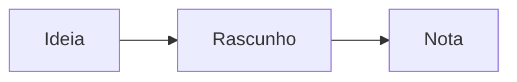

Notas da reunião com ==relatórios personalizáveis== e um link para [[Outra nota]].

## Pontos principais da reunião

- Apresentamos as soluções de **organização de notas** com *Live Preview*.
- Discutimos ==relatórios personalizáveis== que trazem visibilidade ao time.
- Endereçamos dúvidas sobre segurança e conformidade de dados.
- [x] Enviar a apresentação
- [ ] Revisar a fórmula $E = mc^2$ e o diagrama abaixo



```js
// Destaque de sintaxe
const soma = (a, b) => a + b;
console.log(soma(2, 3));
```

| Atalho | Ação |
|---|---|
| Ctrl+E | Ler / Editar |
| Ctrl+S | Salvar |

$$
\int_0^1 x^2\,dx = \frac{1}{3}
$$
