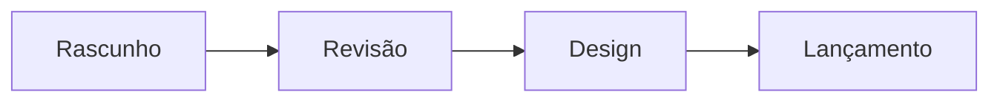

# Plano de lançamento

Da ideia à loja em quatro etapas.

## Cronograma

| Etapa | Responsável | Prazo |
| --- | --- | --- |
| Rascunho | Bianca | 20 out |
| Revisão | Equipe | 24 out |
| Design | Estúdio | 30 out |
| Lançamento | Todos | 5 nov |

## Próximos passos

- [x] Fechar o escopo
- [x] Aprovar a identidade visual
- [ ] Gravar o vídeo de apresentação
- [ ] Publicar na loja
